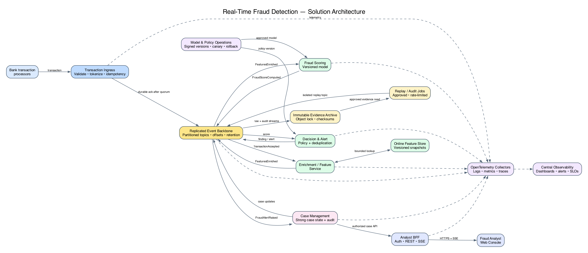
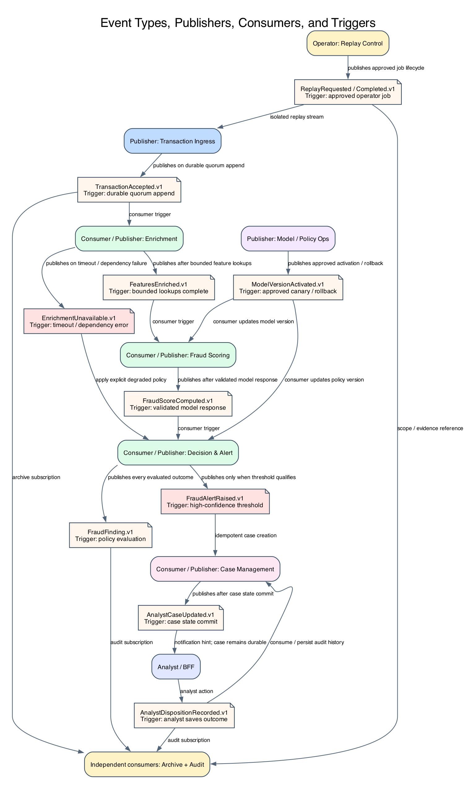
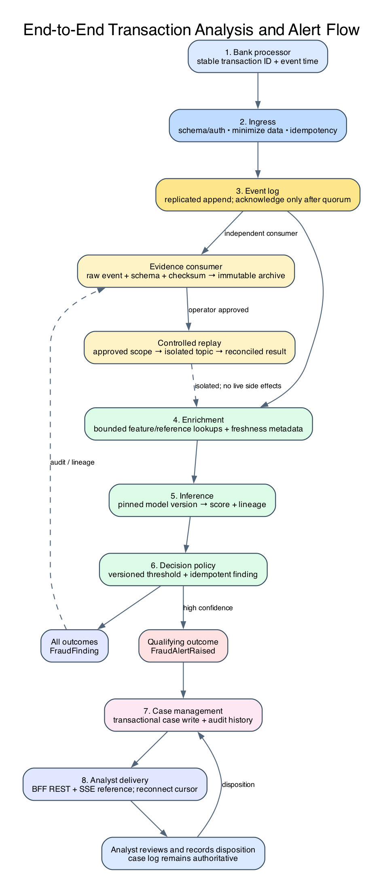
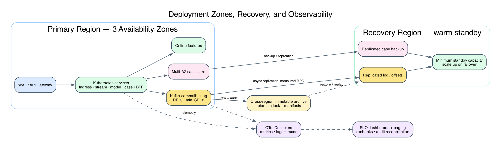

# Real-Time Financial Fraud Detection

**Solution architecture report**

**Version:** 1.0

**Status:** Proposed reference architecture

## Executive summary

Replace the batch-only fraud path with an event-driven system that captures
every eligible transaction in a durable log before acknowledging receipt. A
stream-processing path enriches each event, calls a versioned fraud model,
applies explicit decision policy, and publishes a result. High-confidence
findings create analyst cases and reach the analyst console over a low-latency
push channel. An immutable archive, replay controls, model/version lineage,
and append-only case history support compliance review and investigation.

The design targets **1,000 transactions per second (TPS) peak**, with capacity
tested to at least **2,000 TPS sustained** and a higher short burst. Stateless
services scale horizontally; partitioned messaging and stream workers scale
with load. The initial decisioning path has a measurable target of **99% of
transactions scored within 1 second** from durable intake, rather than treating
the phrase “real time” as an unmeasured guarantee.

No single technology or cloud provider is mandated. Kafka-compatible durable
messaging, Kubernetes, a low-latency online feature store, object-lock archive
storage, OpenTelemetry telemetry, and a web BFF provide a concrete reference
stack while allowing equivalent managed services.

## 1. Problem statement and architecture objectives

The bank needs to move from delayed batch detection to timely risk signals
without losing evidentiary integrity or operating predictably at peak demand.
The system is an **analysis and alerting platform**. Unless separately approved
as part of payment authorization, it does not itself settle, reverse, or
decline a payment.

| Business need | Technical objective |
| --- | --- |
| Detect likely fraud promptly | Produce a versioned score and policy outcome with p99 end-to-end scoring latency below 1 second during the defined operating envelope. |
| Capture and replay transactions | Acknowledge intake only after a replicated durable-log write; preserve raw event evidence and support controlled, auditable replay. |
| Sustain volume | Sustain 1,000 TPS peak; load test 2,000 TPS sustained with headroom for bursts, retries, and replays. |
| Scale economically | Scale stateless services and stream consumers from lag/CPU/latency signals; scale down with safe minimums and cooldowns. |
| Alert analysts | Deliver actionable high-confidence alerts to a live analyst console, with durable cases and reconnect recovery. |
| Operate safely | Correlate metrics, structured logs, and traces; define SLOs, ownership, actionable pages, and recovery procedures. |

### Assumptions and boundaries

- An upstream bank transaction platform is the source of record. The fraud
  platform consumes transaction events and returns analysis; it is not the
  ledger.
- Input contracts include a stable transaction identifier, event time, account
  or customer reference, amount/currency, merchant/channel attributes, and
  schema version. Sensitive fields are minimized or tokenized before analytics.
- The business provides the legal retention period, data residency rules,
  decision policy, alert threshold, and model governance controls. The proposed
  seven-year archive target below is illustrative, not legal advice or a claim
  that seven years is universally required.
- Historical replay is separate from live production decisions. Replayed events
  are marked, isolated, and cannot trigger payment actions or duplicate live
  analyst cases by default.
- “Real time” is measured from durable intake to a score/result; the upstream
  authorization latency budget, if any, must be agreed with payment owners.

## 2. Functional decomposition and service boundaries

Each service has a bounded responsibility, versioned contract, and explicit
trigger. Teams may begin with fewer deployables, but should retain these
logical boundaries. Avoid splitting services solely by nouns: the boundaries
follow ownership of ingest, scoring, outcomes, cases, and analyst delivery.

| Service / component | Responsibility and inputs | Outputs / trigger | Coupling and scaling |
| --- | --- | --- | --- |
| **Transaction Ingress** | Authenticates upstream producers; validates envelope/schema; applies size, rate, and basic field checks; derives idempotency key. | Writes `TransactionAccepted` to the durable log; acknowledges producer after broker quorum confirms. Trigger: upstream event/HTTPS batch. | Stateless; scale by request rate and producer concurrency. Couples to schema registry and broker protocol, not model code. |
| **Event Backbone** | Replicated, partitioned append-only transaction and result topics; preserves order within configured key, offsets, and replay position. | Delivers events to independent consumer groups. Trigger: successful append. | Partition count and broker throughput bound parallelism. Multi-AZ replicas; retention and archive policies managed separately. |
| **Enrichment / Feature Service** | Joins event with approved reference data and online features using bounded timeouts; records feature snapshot/version. | Emits `FeaturesEnriched`; emits explicit incomplete-data signal on timeout rather than waiting indefinitely. Trigger: `TransactionAccepted`. | Stateless consumers scale on lag and processing time. Online feature store is a dependency; use circuit breaker and freshness metadata. |
| **Fraud Scoring Service** | Calls the deployed, signed model with features and model version; validates output and timeout. | Emits `FraudScoreComputed` containing score, model/version, feature snapshot reference, and processing metadata. Trigger: `FeaturesEnriched`. | Replicas scale horizontally, ideally with accelerator-free CPU inference initially. Model serving throughput and feature access must be load tested. |
| **Decision and Alert Service** | Applies governed thresholds, policy, and deduplication to score results. | Emits `FraudFinding` for all outcomes; emits `FraudAlertRaised` only for qualifying high-confidence cases. Trigger: `FraudScoreComputed`. | Stateless consumers scale independently. Threshold changes are versioned, authorized, and auditable. |
| **Case Management Service** | Creates or updates analyst cases idempotently, stores assignment/state/notes and immutable disposition history. | Emits `AnalystCaseUpdated` and `AnalystDispositionRecorded`. Trigger: `FraudAlertRaised` or an analyst command. | API and workers scale separately. Strong consistency is required for case state; it is not required for analytics aggregates. |
| **Analyst BFF and Web UI** | Enforces analyst authorization, shapes API responses, handles pagination/search, and streams case updates. | REST/HTTPS responses and SSE updates; reconnect can resume by cursor or refresh. Trigger: analyst request or case update. | BFF scales statelessly; UI receives only role-authorized case data. Push disconnects must not lose durable cases. |
| **Replay and Archive Service** | Archives accepted raw events and schemas to immutable object storage; manages approved replay jobs and checkpoints. | Emits `ReplayRequested`/`ReplayCompleted`; writes replayed events to isolated replay topics. Trigger: retention policy or approved operator request. | Archive I/O and replay workers scale separately from live scoring; quotas prevent replay from starving live traffic. |
| **Model / Feature Operations** | Publishes reviewed model artifacts, feature definitions, policy versions, and deployment metadata. | Emits `ModelVersionActivated` or rollback event. Trigger: approved release pipeline. | Not on the per-transaction hot path except version resolution. Supports canary and rapid rollback. |

Ingress performs transport/schema validation only. Feature enrichment, model
inference, alert decisions, and case management remain independently deployable
and observable. The event backbone reduces synchronous service coupling; it
also introduces eventual consistency, schema governance, and operational
complexity that must be owned.

## 3. Solution architecture



The **live lane** prioritizes bounded latency and isolation: accepted events
flow through enrichment, scoring, and decisioning to findings and cases. The
**evidence lane** copies the same accepted event stream to immutable object
storage, retaining original bytes, schema/version references, and integrity
metadata. The **analyst lane** reads durable case state and pushes notifications
as a convenience; the push channel is not the authoritative record.

### Core event contracts

All events use a versioned envelope, such as CloudEvents, with `id`,
`type`, `source`, `subject`, `time`, `schemaVersion`, `correlationId`,
`causationId`, `tenantOrBankId`, and a payload reference or minimized payload.
Money uses integer minor units plus ISO currency, never floating point.
`occurredAt` (source time) is distinct from `receivedAt` and `processedAt`.
Events include a classification and privacy label; PAN, credentials, and
unnecessary personal data must not be placed in general-purpose logs.

| Event | Publisher → consumer(s) | When and why |
| --- | --- | --- |
| `TransactionAccepted.v1` | Ingress → enrichment, archive, compliance counters | A valid unique transaction has been durably appended; canonical live-path input and replay evidence. |
| `FeaturesEnriched.v1` | Enrichment → scoring | Required features were fetched or explicitly marked missing/stale; preserves feature snapshot/version lineage. |
| `EnrichmentUnavailable.v1` | Enrichment → decision policy / operations | A bounded enrichment timeout or dependency error occurred; invoke the approved degraded-mode policy and alert operations. |
| `FraudScoreComputed.v1` | Scoring → decision/alert, analytics | A model returned a validated score with model and feature versions. |
| `FraudFinding.v1` | Decision → analytics, case workflow | A policy version converted a score into a risk classification, including non-alert outcomes. |
| `FraudAlertRaised.v1` | Decision → case management, analyst notifications | Confidence/policy threshold met; deduplicated case creation requested. |
| `AnalystCaseUpdated.v1` | Case management → BFF notification, audit archive | Case assigned, reviewed, or updated; UI refresh is asynchronous to durable write. |
| `AnalystDispositionRecorded.v1` | Case management → audit/analytics/model governance | Analyst records confirmed fraud, false positive, or other approved outcome. |
| `ReplayRequested.v1` / `ReplayCompleted.v1` | Replay service → operators/audit | An authorized replay job starts/completes, with scope, requester, offsets, destination, and counts. |
| `ModelVersionActivated.v1` | Model operations → scoring/decision services | A validated model or policy version is activated, canaried, or rolled back. |

### Event flow and triggers



Event payloads should be intentionally narrow. A representative score event
contains a transaction reference, score and score scale, decision timestamp,
model artifact/version, feature snapshot/version, policy version if already
applied, and trace/correlation identifiers. A finding adds risk band, reason
codes approved for analyst use, and an idempotent decision identifier. Schema
changes are backward-compatible by default and checked in CI against registered
consumer contracts.

### End-to-end transaction path



1. The upstream processor sends a transaction with stable event and transaction
   IDs. Ingress validates schema, authenticates the producer, strips or
   tokenizes restricted fields, and checks duplicate ID.
2. Ingress appends a canonical event using a partition key selected for the
   required ordering boundary (often account/customer, subject to hot-key
   analysis). It acknowledges only after replicated broker confirmation. A
   duplicate returns the original accepted reference rather than creating a
   second logical transaction.
3. Independent consumers enrich the event and write the raw evidence to the
   archive path. Enrichment has strict deadlines; stale/missing features are
   explicit, not silently substituted.
4. Scoring uses a pinned active model version and emits score lineage.
   Decisioning applies a separately versioned policy and emits a finding.
5. A qualifying alert creates/updates a case idempotently. The BFF pushes a
   notification to authorized analysts; the UI loads the durable case over
   authenticated HTTPS and can recover after reconnect.
6. Every transition records event IDs, timestamps, model/policy versions,
   correlation IDs, and relevant offsets for investigation and replay.

## 4. Frontend and analyst experience

The browser application calls an **Analyst BFF** rather than messaging
infrastructure directly. REST endpoints provide case search, detail, assignment,
disposition, and audit history with cursor pagination. Server-Sent Events
(SSE) deliver new/updated case references with a `Last-Event-ID` cursor; WebSocket
is an alternative if bidirectional collaboration is later required. The UI
fetches full case detail on demand, not every transaction payload.

The BFF verifies SSO/OIDC identity, analyst role, case-level entitlements, CSRF
protection for state-changing browser requests, and rate limits. It returns
minimal data and short-lived authorized links where evidence access is needed.
The frontend treats notifications as hints: on reconnect or a sequence gap it
fetches cases since its last durable cursor. Search and dashboards may use
eventually consistent read models, while assignment and disposition writes
require strong transactional updates and audit records.

## 5. Technology choices

| Layer | Reference choice | Rationale and trade-off |
| --- | --- | --- |
| Ingress/API | Go or Java service on Kubernetes; mTLS/OAuth2 client credentials | Predictable high-concurrency service with mature bank security controls. Language choice should follow operational expertise; duplicate prevention must be durable, not process-local. |
| Event backbone | Kafka-compatible managed service, three AZs, replication factor 3, min in-sync replicas 2 | Partitioned durable log supports independent consumer groups, back-pressure, and offset replay. Requires partition/retention planning and specialist operations. |
| Stream processing | Kafka Streams, Flink, or equivalent managed stream engine | Stateful enrichment, windows, retries, and checkpointing scale by partitions. Choose one primary engine to avoid duplicated operational models. |
| Online features | Low-latency distributed KV/feature store with regional replicas and versioned feature snapshots | Supports bounded inference latency. Cache/reference staleness can reduce model quality; every lookup needs freshness and fallback semantics. |
| Model serving | Containerized model server with immutable, signed artifacts and CPU-first autoscaling | Keeps model rollout, canary, and rollback independent of ingress. Accelerator adoption is based on measured throughput and latency, not assumed. |
| Case store | Relational database with multi-AZ failover and append-only audit table | Strong consistency for case ownership and disposition. Read replicas/read models support search; writes are not spread through eventual-consistency stores. |
| Evidence archive | Encrypted object storage with versioning, retention lock/WORM, lifecycle tiers, and cross-region replication | Economical long retention and replay source. Retrieval is slower than live Kafka; legal holds and deletion exceptions need explicit governance. |
| Analyst UI/BFF | TypeScript SPA and stateless BFF behind WAF/API gateway | Separates browser authorization and UX from internal events. Push is non-authoritative; durable case storage enables reconnect recovery. |
| Runtime | Managed Kubernetes across at least three AZs, autoscaling, infrastructure as code | Portable scaling and isolation. Kubernetes is not itself high availability: node pools, control plane, quotas, and deployments need operational design. |
| Telemetry | OpenTelemetry SDK/Collector; Prometheus-compatible metrics; centralized log and trace backend | Vendor-neutral instrumentation and correlation. Sampling/retention must preserve high-value fraud and error evidence without uncontrolled telemetry cost. |

## 6. Throughput, latency, and elastic scaling

Capacity is an end-to-end property. A 1,000 TPS ingress benchmark is not enough
if features, inference, broker consumers, or case writes saturate first.

- **Target envelope:** 1,000 TPS peak steady load; prove 2,000 TPS for at least
  30 minutes, with an agreed short burst target (initially 3,000 TPS for 5
  minutes). Size message bytes, not only event count; benchmark typical and
  worst-case payloads.
- **Ingress:** stateless replicas scale by request concurrency and p95 latency.
  Apply per-producer quotas and bounded queues. Acknowledge after replicated
  broker write, not after all downstream analysis.
- **Messaging:** partition count enables parallel consumers; choose enough
  partitions for 2x tested consumer parallelism, then validate hot-key
  distribution and broker network/disk throughput. Replication, retention, and
  rebalancing consume capacity. Throttle replay independently.
- **Consumers:** autoscale on consumer lag, oldest-event age, processing
  saturation, and downstream quotas, with min/max replicas and cooldowns.
  Avoid scaling faster than the feature store or model-serving dependency can
  support.
- **Inference:** load-test p50/p95/p99 including feature reads and model cold
  starts. Pre-warm a minimum pool, canary new models, and use bounded batch
  sizes only when they meet latency SLOs.
- **Case/UI:** decouple case creation from browser presence; scale notification
  gateways on connected clients and fan-out rate. Paginated query/read models
  protect the transactional case store.
- **Cost control:** use scale-to-zero only for non-critical replay/reporting
  jobs. Keep minimum live replicas and reserved broker capacity. Scale down
  gradually only after lag drains and cooldown expires.

### SLOs and service indicators

SLO windows below are initial targets for a rolling 30-day period and require
agreement with business, operations, and risk owners. “Eligible” traffic
excludes malformed events rejected at ingress; exclusions are measured and
reported.

| SLI / objective | Target | Measurement |
| --- | --- | --- |
| Durable acceptance availability | **99.99%** of valid producer requests receive durable acceptance or an explicit bounded failure response; no success response before broker quorum acknowledgement. | Valid request count vs accepted/failed; broker produce result, producer-visible latency. |
| End-to-end scoring latency | **99% within 1 second** and **99.9% within 3 seconds** from broker append time to `FraudFinding` under target load. | `processed_at - accepted_at`, histogram by outcome and workload; exclude replay in separate series. |
| Alert availability/latency | **99.9%** of qualifying findings create a durable case within 2 seconds; **99%** of connected analyst sessions receive a notification within 3 seconds. | Finding-to-case and case-to-push timestamps; delivery acknowledgements, reconnect gaps. |
| Evidence completeness | **100% of durably accepted IDs** are represented in archive manifests within 15 minutes; any gap pages evidence operations. | Distinct accepted IDs/offsets versus archive manifests and checksums. |
| Replay correctness | **100%** of approved replay job offsets are accounted as processed, rejected, or explicitly skipped with reason; replay is isolated from live side effects. | Job-level offset/record reconciliation and duplicate side-effect checks. |

SLOs are not promises until verified by load, chaos, and production-like tests.
Report latency distributions, not averages. Keep replay, canary, and live
traffic separate so a large replay cannot hide user-facing degradation.

## 7. Observability and operations

Instrument at ingress, broker producer/consumer, feature calls, model serving,
decisioning, case writes, BFF, and browser delivery. Use OpenTelemetry
trace-context propagation through message headers and HTTP calls. Each event
has a stable `event_id`, `transaction_id` token/reference, `correlation_id`,
`causation_id`, partition/offset, and model/policy version.

### Collection and correlation

- **Metrics:** OpenTelemetry metrics exported by collectors to a
  Prometheus-compatible time-series backend. Use bounded-cardinality labels
  (`service`, `region`, `topic`, `model_version`, `outcome`); never label by
  transaction ID, account, or customer. Dashboard service and SLO views.
- **Logs:** structured JSON to an agent/collector, then centralized indexed
  storage with role-limited access and retention tiers. Include trace/span IDs,
  event IDs, decision version, and error class. Redact/tokenize sensitive data
  before emission; prohibit PAN, secrets, and raw feature payloads from
  general logs.
- **Traces:** W3C Trace Context propagated across synchronous spans and
  represented in event headers across asynchronous boundaries. Create
  producer/consumer spans linked by trace/correlation IDs; do not keep a
  request span open while waiting for downstream asynchronous work.
- **Audit evidence:** business audit records (acceptance, model/policy version,
  finding, case transition, replay, access) are a separate protected evidence
  stream, not ordinary diagnostic logs. Apply immutable retention, access
  controls, integrity verification, and legal holds.
- **Sampling:** head-sample routine successes, tail-sample slow/error traces,
  and retain every high-confidence decision/audit event in the evidence
  pipeline. Sampling never means dropping transaction capture or business
  audit evidence.

### Key operational metrics and alerting

At minimum, alert on these three groups:

1. **Decision latency / deadline misses:** p99 accept-to-finding duration,
   percentage over 1 second, and age of oldest unprocessed event. Page when
   p99 exceeds SLO burn thresholds or lag threatens the 3-second tail target.
2. **Durable capture health:** producer append errors, under-replicated
   partitions, ISR below minimum, rejected/duplicate rates, and archive
   manifest completeness. Page immediately for replication safety or evidence
   gaps; never mask this with retries alone.
3. **Detection and alert delivery:** score/finding/alert counts and
   distributions by model/policy version, case-write failures, notification
   delay, and analyst reconnect gaps. Alert on sudden shifts and pipeline
   silence; alert-rate anomalies are signals, not proof of fraud or system
   health.

Also monitor feature-store latency/freshness, model timeout/error rate,
consumer lag by group, broker disk/network, database saturation, autoscaler
replica limits, replay backlog, error-budget burn, and deployment canary
outcomes. On-call runbooks map each alert to owner, severity, dashboard,
mitigation, and evidence-preserving recovery.

## 8. Resilience, recovery, and data integrity

| Failure mode / potential SPOF | Mitigation and behavior | Loss detection and recovery |
| --- | --- | --- |
| Broker AZ or node loss | Three-AZ replication; RF=3, min ISR=2; client retries with bounded backoff; ingress returns explicit unavailable if quorum cannot be reached. | Alert on ISR/under-replication. Restore from replicas; reconcile producer IDs and archive manifests. |
| Regional outage | Warm/standby second region with replicated log/archive and pre-provisioned minimum capacity; documented failover authority and split-brain prevention. | Define tested RPO/RTO with risk owners (initial target RPO ≤1 minute, RTO ≤15 minutes, subject to replication evidence). Reconcile offset watermarks before resuming. |
| Consumer crash / poison event | At-least-once delivery, idempotent writes, retry topics with bounded attempts, then quarantine/DLQ with reason and original reference. | Re-drive after fix from saved offset; reconcile accepted IDs against findings and exception queues. |
| Feature store slow/unavailable | Tight timeout, bulkhead, circuit breaker, cached approved features with freshness marker, explicit missing-feature policy. | Measure degraded decisions and feature staleness; restore dependency, replay affected IDs under controlled policy. |
| Model serving failure or bad rollout | Health/readiness, canary, version pinning, circuit breaker and rollback to last approved model. Keep policy-defined fallback/hold behavior; do not silently classify as safe. | Preserve event and model/version metadata; replay affected cohort for comparison and case remediation. |
| Case database outage | Multi-AZ database failover; durable `FraudAlertRaised` remains in broker until case worker recovers; idempotent case key. | Monitor alert-to-case gap; replay consumer offsets and reconcile cases before closing incident. |
| Archive writer or object store outage | Independent consumer group, durable broker retention buffer, retry with bounded backoff; never block scoring on archive latency, but raise evidence SLO breach. | Compare topic offsets/IDs with signed archive manifests; backfill from broker while retention permits; restore from cross-region copies. |
| Analyst push/BFF outage | Durable case state is authoritative; reconnect with cursor and query since last seen; multi-AZ gateways. | Rebuild notifications from case update log; analyst can search current open cases. |
| Model or feature data drift | Drift and outcome monitoring, approval gates, champion/challenger, rollback and kill switch. | Retain snapshots/version lineage; evaluate affected decisions and document corrective action. |

No architecture removes all single points of failure. Explicitly identify
control-plane dependencies (identity provider, DNS, KMS, schema registry,
deployment pipeline, and cloud account quotas) in operational design. Maintain
break-glass access with dual control, tested backups of configuration and
schemas, key recovery procedures, and independent monitoring where practical.

### Delivery semantics and replay

The design uses **at-least-once delivery** because retries and consumer
restarts are expected. Idempotency keys (source + transaction ID + event
version) prevent duplicate logical outcomes. Exactly-once broker processing
does not make side effects in an external relational database exactly once;
use inbox/outbox or transactional deduplication in case workflows.

Archive raw canonical envelopes with schema versions, source metadata, original
event time, broker topic/partition/offset, and cryptographic checksums. Store
objects under retention lock/WORM with KMS encryption, access logging, legal
hold support, and documented deletion/exception process. Replays are
operator-approved, reason-coded, scoped by time/IDs/model version, checkpointed,
rate-limited, and isolated to replay topics. A replay writes comparison results
to a separate namespace and does not create live alerts unless a second,
explicitly approved remediation workflow requests it.

## 9. Security, privacy, and financial-services controls

- Use mutual TLS service identity, short-lived workload credentials, least
  privilege topic/database access, and separate producer/consumer principals.
- Encrypt traffic in transit and data at rest with managed keys; rotate keys
  and test recovery. Segregate production, replay, analytics, and model
  development environments.
- Minimize sensitive data in events; tokenize account identifiers and restrict
  re-identification to authorized case workflows. Apply data classification,
  residency, retention, legal hold, and access review controls.
- Sign model artifacts and record provenance, training-data lineage, approval,
  evaluation, deployment, and rollback. Version the decision policy separately
  from model artifacts. Analysts receive reason codes suitable for action;
  raw features and model internals require role-based access.
- Audit analyst access, case reads/updates, threshold changes, replay requests,
  and model activation. Preserve a tamper-evident record and require dual
  approval for sensitive operations.
- Threat-model event spoofing, replay abuse, poisoned inputs, insider access,
  data exfiltration, and denial-of-service. Validate schemas and cap payload
  sizes at ingress; use WAF/API quotas and anomaly detection.

## 10. Service mesh, BFF, caching, and event-driven patterns

- **Event-driven backbone:** provides durable decoupling, independent
  consumption, buffering, and replay. Costs include eventual consistency,
  schema evolution, partition operations, and debugging across asynchronous
  boundaries. Contracts, IDs, trace propagation, and ownership are mandatory.
- **Service mesh:** optional but recommended if the bank standardizes on one.
  It can provide mTLS, workload identity, traffic policy, retries/timeouts, and
  uniform telemetry. It does not replace application authorization, event
  idempotency, or broker security; sidecar/control-plane overhead must be
  measured at 1k+ TPS.
- **BFF:** isolates browser-facing auth, response shaping, rate limits, and
  notification fan-out. It avoids exposing internal topics or service topology
  to browsers, at the cost of another service to operate.
- **Caching:** use short-lived caches for public/reference configuration and
  non-sensitive read views where freshness is explicit. Do not use a cache as
  the system of record for balance, cases, transaction capture, or replay
  evidence. Cache invalidation and stale model features are risk-bearing
  behavior and must be observable.
- **Resilience patterns:** deadlines, bulkheads, bounded retries with jitter,
  circuit breakers, DLQs, canary deployments, and idempotent consumers contain
  failure. Retries are not a substitute for capacity or evidence reconciliation.

## 11. Deployment and operational readiness

Deploy on a managed Kubernetes platform across three availability zones, with
separate node pools and resource quotas for ingress, streaming, inference,
case APIs, and telemetry collectors. Use infrastructure as code, signed
images, private networking, policy-as-code, and staged deployment gates.
Prefer managed Kafka, managed relational storage, and object storage when they
meet residency, key control, retention-lock, and recovery requirements; a
self-managed platform needs a clearly staffed 24/7 ownership model.



Before launch, run load tests at normal and peak event sizes, broker/consumer
failure injection, AZ loss, feature-store/model timeouts, case-store failover,
archive reconciliation, analyst reconnect, and regional DR exercises. Replay
tests must prove both completeness and isolation from live side effects.

### Audit and end-of-financial-year readiness

Audit and financial-year activities can coincide with unusually high read,
export, and replay workloads. Prepare rather than assume average-load
capacity:

- Forecast audit/replay volumes and reserve broker/archive/network capacity;
  provision temporary consumers and query read replicas before the window.
- Run replay on dedicated quotas and topics with rate caps; prioritize live
  scoring and alerting. Require approval and record job scope, requester,
  versions, offsets, and reconciliation.
- Test peak and 2x peak load before the period; validate autoscaler maximums,
  cloud quotas, IP/connection limits, KMS/API quotas, and database connection
  pools.
- Freeze risky model/schema changes during the audit window except emergency
  rollback; publish an incident and escalation rota with fraud operations,
  platform, security, and compliance owners.
- Monitor evidence manifest completeness and consumer lag continuously; produce
  signed reconciliation reports after each replay/export.

## 12. Trade-offs and open decisions

| Decision | Benefit | Cost / risk | Decision gate |
| --- | --- | --- | --- |
| Durable event log before acknowledgement | No accepted event is dependent on an in-memory request path; replay and independent consumers are possible. | Adds broker latency and means intake can fail when quorum is unavailable. | Define producer retry/idempotency and acceptable upstream back-pressure behavior. |
| Asynchronous score/alert path | Isolates producer latency from model and analyst availability; absorbs bursts. | Findings are eventually consistent; not suitable alone for a strict synchronous authorization decision. | Confirm whether authorization needs an inline score and set its separate latency/failure policy. |
| At-least-once plus idempotency | Operationally realistic across brokers and external stores. | Deduplication windows/keys and downstream transactional effects require careful design. | Define global transaction identity, retention, and collision behavior. |
| Immutable archive and multi-region copy | Strong evidence and recovery basis. | Retention, legal holds, privacy deletion, cost, and replication lag become governance concerns. | Legal/compliance owners approve retention, residency, RPO/RTO, and hold policy. |
| Model-driven score plus separate policy | Model can evolve without embedding business/legal thresholds; decisions are explainable by version. | Two versioned systems and rollout/rollback process to govern. | Model-risk management approves validation, reason codes, and monitoring. |
| Managed cloud services | Less undifferentiated operations and faster recovery options. | Provider limits, cost, regional availability, and lock-in. | Validate controls, quotas, exit strategy, and portability at procurement. |

Open design inputs include jurisdiction-specific retention and residency,
producer event contract, exact definition of “real time,” upstream
authorization/fail-open-or-hold policy, fraud confidence threshold, alert
volumes and analyst staffing, model explainability requirements, regional DR
objectives, and approved cloud provider. Resolve these with legal, fraud
operations, model risk, payment owners, security, and SRE before production
commitment.

## Appendix A: diagram source

Editable Graphviz source for every report diagram is in `diagrams/*.dot`.
Re-render PNG files from the repository root with:

```bash
dot -Tpng -Gdpi=160 diagrams/solution-architecture.dot \
  -o diagrams/solution-architecture.png
dot -Tpng -Gdpi=160 diagrams/event-flow.dot -o diagrams/event-flow.png
dot -Tpng -Gdpi=160 diagrams/end-to-end-flow.dot \
  -o diagrams/end-to-end-flow.png
dot -Tpng -Gdpi=160 diagrams/deployment-resilience.dot \
  -o diagrams/deployment-resilience.png
```
